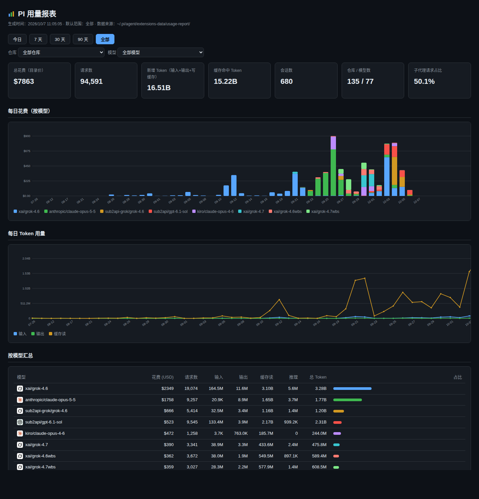

# pi-usage-report

[Pi](https://github.com/badlogic/pi-mono) 用量看板扩展：记录每次模型调用的 token 与花费，一条命令生成自包含的离线 HTML 报表（无 CDN、无外部服务、无 emoji）。



## 安装

```bash
pi install git:github.com/KonglingDaDa/pi-usage-report
```

## 用法

在 Pi 会话里：

- `/usage-report` — 最近 30 天
- `/usage-report 7` / `/usage-report 90` / `/usage-report all` — 指定天数或全部
- `/usage-report backfill` — 扫描 `~/.pi/agent/sessions/` 的历史会话（含子代理 run 目录），把存量用量补进账本（自动去重，可重复跑）

报表会在浏览器中打开；也可以直接打开 `~/.pi/agent/extensions-data/usage-report/usage-report.html`。

页面功能：今日 / 7 天 / 30 天 / 90 天 / 全部切换，今日视图按小时出趋势；仓库、模型两个下拉筛选全图联动；URL 加 `?sub` 只看子代理用量。

## 数据

- 账本：`~/.pi/agent/extensions-data/usage-report/usage-YYYY-MM.jsonl`（API 响应自带的 usage 与 Pi 按目录价算的 cost，纯追加）
- 本地存储，不上传任何地方；订阅用户的额度消耗请以服务商后台为准

## License

MIT
